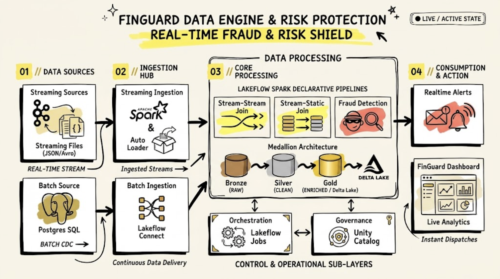

<div align="center">

# 🛡️ FINGUARD : REAL-TIME FRAUD & RISK SHIELD


[](https://spark.apache.org/)
[](https://databricks.com/)
[](https://delta.io/)
[](https://confluent.cloud/)
[](https://www.postgresql.org/)
[](LICENSE)

<br/>

<p align="center">
  <b>FinGuard</b> is a production-grade streaming risk engine engineered to intercept fraudulent credit card transactions the moment they occur. By combining <b>Confluent Cloud Kafka</b>, <b>Apache Spark Structured Streaming</b>, and <b>Databricks Lakeflow (Delta Live Tables)</b>, FinGuard reconciles unbounded real-time payment streams with dynamic threat intelligence in sub-seconds.
</p>

---

</div>

## 📐 SYSTEM ARCHITECTURE

The entire streaming topology is organized into an event-driven **Medallion Lakehouse Architecture** operating under **Unity Catalog governance**:

<div align="center">



</div>

### 🏗️ Pipeline Tier Breakdown

| Code | Stage | Ingestion / Processing Tech | Core Responsibility |
| :---: | :--- | :--- | :--- |
| **`01`** | **Data Sources** | Confluent Cloud Kafka & PostgreSQL | Ingests live card swiping events via Kafka (`SASL_SSL`) alongside historical customer profiles via database CDC. |
| **`02`** | **Ingestion Hub** | Spark Structured Streaming & Auto Loader | Raw event extraction; Databricks `cloudFiles` continuously ingests incoming fraud watchlist files with schema inference. |
| **`03`** | **Core Processing** | Databricks Lakeflow (Delta Live Tables) | Multitier Medallion architecture: **Bronze** raw ingestion, **Silver** expectation sanitization, and **Gold** watermarked joins. |
| **`04`** | **Action & Insights** | ForeachBatch Sinks & AI/BI Lakeview | Dispatches responsive Neo-Brutalist incident notifications to cardholders and surfaces live metrics to security desks. |

---

## 💡 WHAT IS FINGUARD? (THE 30-SECOND ELEVATOR PITCH)

> Traditional banking systems detect fraud **hours or days after settlement** — when the money is already gone.
> **FinGuard flips the paradigm:** it processes transactions **mid-flight**.


### 🎯 Real-World Scenario
1. **The Event:** A stolen credit card is swiped at a luxury electronics store in Paris for **$4,850.00**.
2. **The Threat Intel:** Three minutes earlier, interpol or the issuing bank flagged that card on a global watchlist.
3. **The Interception:** FinGuard executes a **5-minute sliding watermarked stream-stream join** between the Kafka transaction stream and the Auto Loader watchlist stream.
4. **The Response:** In less than **800 milliseconds**, the transaction is classified as high-risk, cataloged in Gold Delta tables, and a high-priority incident dossier is generated and emailed to the cardholder.

---

## ⚡ KEY CAPABILITIES

- **⏱️ Sub-Second Ingestion**: Connects directly to Confluent Cloud Kafka clusters over encrypted `SASL_SSL` protocols with zero event loss.
- **🔗 Watermarked Stream-Stream Joins**: Statefully pairs dynamic credit card streams with live security watchlists across a 5-minute temporal window.
- **🛡️ Strict Data Quality Guards**: Enforces real-time Delta Live Tables expectations (`@dp.expect_or_drop`) to reject malformed records, null customer keys, or negative amounts before they contaminate analytical layers.
- **✉️ Neo-Brutalist Incident Alerts**: Dedicated `ForeachBatch` streaming sinks generate formatted, high-contrast HTML security alerts sent via SMTP.
- **📈 Real-Time Executive Monitoring**: Out-of-the-box Databricks AI/BI Lakeview Dashboard (`.lvdash.json`) providing instant metrics on fraud volume, high-risk merchant categories, and velocity anomalies.
- **🔐 Zero-Trust Credential Isolation**: Decoupled connection secrets using Databricks Secret Scopes (`finguard-scope`).

---

## 🧰 TECHNICAL SPECIFICATIONS

<div align="center">

| Domain | Technology | Implementation Details |
| :--- | :--- | :--- |
| **Event Streaming** | `Confluent Cloud Kafka` | Distributed topic partitioned for credit card transactions with JSON serialization. |
| **Stream Engine** | `Apache Spark` / `PySpark` | Structured Streaming with micro-batch trigger modes (`availableNow=True` & streaming). |
| **Lakehouse Platform**| `Databricks Lakeflow` | Declarative pipelines managing Bronze, Silver, and Gold Delta tables. |
| **Storage & Governance**| `Delta Lake 3.0` + `Unity Catalog`| ACID transactions, volume storage for incremental files, schema enforcement. |
| **File Ingestion** | `Databricks Auto Loader` | Efficient `cloudFiles` source ingesting streaming JSON watchlist drops. |
| **Relational CDC** | `PostgreSQL` | Relational source storing customer demographics and baseline spend thresholds. |
| **Incident Sinks** | `Python SMTP + MIME` | Asymmetric Bento Neo-Brutalist email layouts formatted for mobile & desktop. |
| **Telemetry & BI** | `Databricks Lakeview AI/BI` | Vector-rendered monitoring dashboards visualizing live KPI metrics and trendlines. |

</div>


## 🚀 HOW TO RUN & DEPLOYMENT GUIDE


### Step 1: Initialize the Local Kafka Simulator

The producer simulates realistic customer spending patterns, normal transactions, velocity fraud, and stolen card traffic.

```bash
# 1. Enter producer directory
cd kafka_producer

# 2. Setup virtual environment
python -m venv .venv

# On Linux/macOS:
source .venv/bin/activate
# On Windows PowerShell:
.\.venv\Scripts\Activate.ps1

# 3. Install dependencies
pip install -r requirements.txt

# 4. Create your local .env configuration
cp .env.example .env
```

Edit `.env` with your Confluent Cloud or local Kafka cluster credentials:
```env
BOOTSTRAP_SERVERS=your-confluent-cluster.confluent.cloud:9092
API_KEY=YOUR_CONFLUENT_API_KEY
API_SECRET=YOUR_CONFLUENT_API_SECRET
TOPIC_NAME=credit_card_transactions
TRANSACTIONS_PER_SECOND=5
FRAUD_PERCENTAGE=0.08
TOTAL_CUSTOMERS=1000
TOTAL_MERCHANTS=200
```

Start the transaction generator:
```bash
# Normal traffic mixed with organic fraud
python producer_normal.py

# Simulate targeted watchlist card swipes
python producer_fraud_card.py

# Simulate high-velocity rapid swiping attacks
python producer_fraud_transaction.py
```

---

### Step 2: Configure Databricks Unity Catalog & Secrets

1. Open your Databricks Workspace and create the catalog and schemas:
   ```sql
   CREATE CATALOG IF NOT EXISTS fineguard;
   CREATE SCHEMA IF NOT EXISTS fineguard.bronze;
   CREATE SCHEMA IF NOT EXISTS fineguard.silver;
   CREATE SCHEMA IF NOT EXISTS fineguard.gold;
   CREATE VOLUME IF NOT EXISTS fineguard.source.fraud_watchlist;
   ```

2. Run `02 Setup Secret Scope.py` in your workspace to securely register your credentials in `finguard-scope`:
   - `kafka_connection_details` (bootstrap servers, topic, API keys)
   - `gmail_api_key` (Google App Password for automated alerts)

---

### Step 3: Deploy Lakeflow Declarative Pipelines

1. In Databricks, navigate to **Delta Live Tables** / **Pipelines** > **Create Pipeline**.
2. Set **Target Catalog** to `fineguard` and **Target Schema** to `gold`.
3. Add the following pipeline source folders from this repository:
   - `databricks notebooks and pipelines/fineguard project/finguard_streaming/bronze/`
   - `databricks notebooks and pipelines/fineguard project/finguard_streaming/silver/`
   - `databricks notebooks and pipelines/fineguard project/finguard_streaming/gold/`
   - `databricks notebooks and pipelines/fineguard project/finguard_streaming/alert/`
4. Click **Start** to trigger continuous real-time processing.

---

### Step 4: Import the Monitoring Dashboard

1. In Databricks, go to **Dashboards** > **Create Dashboard**.
2. Click the three dots menu (**⋮**) in the top right > **Import Dashboard from File**.
3. Select [`dashboard/FinGuard Fraud Detection Monitoring.lvdash.json`](dashboard/FinGuard%20Fraud%20Detection%20Monitoring.lvdash.json).
4. Connect the dashboard widgets to your `fineguard.silver.transactions` and `fineguard.gold.*` tables.

---

## 📂 PROJECT STRUCTURE

```tree
finguard_streaming_project/
├── references/
│   └── architecture.png                     # Architectural system diagram
├── dashboard/
│   └── FinGuard Fraud Detection Monitoring.lvdash.json  # Prebuilt Databricks Lakeview Dashboard
├── databricks notebooks and pipelines/
│   └── fineguard project/
│       ├── 01 kafka streaming.py            # Direct Spark-Kafka streaming test harness
│       ├── 02 Setup Secret Scope.py         # Automated Databricks Secret Scope builder
│       ├── 03_Send_Email.py                 # Standalone SMTP alert validator
│       ├── 04_Autoloader_test.py            # Auto Loader cloudFiles ingestion harness
│       ├── finguard_customers_silver_ingestion/
│       │   └── silver/customers_silver.py   # Customer dimension profile processing
│       ├── finguard_streaming/
│       │   ├── bronze/                      # Bronze raw streaming tables (Kafka & Watchlist)
│       │   ├── silver/                      # Silver clean tables with DLT expectations
│       │   ├── gold/                        # Gold watermarked joins & minute aggregations
│       │   └── alert/                       # ForeachBatch Neo-Brutalist email dispatch sinks
│       └── fraud_watchlist_file_generator/
│           ├── fraud_watchlist.csv          # Watchlist seed records
│           └── fraud_watchlist_data_generator.py # File emitter to Unity Catalog Volumes
├── kafka_producer/
│   ├── .env.example                         # Safe configuration template
│   ├── config.py                            # Settings dataclasses & validation
│   ├── customer_generator.py                # Synthetic customer generator
│   ├── merchant_generator.py                # Synthetic merchant profile generator
│   ├── fraud_engine.py                      # Rule & probability scoring engine
│   ├── models.py                            # Dataclasses for transactions and metrics
│   ├── producer_normal.py                   # Continuous multi-threaded transaction generator
│   ├── producer_fraud_card.py               # Watchlist card test suite
│   ├── producer_fraud_transaction.py        # Velocity anomaly test suite
│   ├── update_csv_email.py                  # Batch email normalizer
│   ├── utils.py                             # Payload verification helpers
│   └── requirements.txt                     # Python simulator dependencies
├── postgres sql/
│   ├── customers_historic.sql               # Baseline historical customer records
│   └── customers_incremental.sql            # Change Data Capture (CDC) increments
├── .gitignore                               # Git security exclusions
└── README.md                                # Project documentation
```

---

## 📜 LICENSE

Distributed under the **MIT License**. See `LICENSE` for more information.

<div align="center">
  <sub>Engineered for enterprise-scale streaming data protection. Built with Databricks Lakeflow, Apache Spark, Confluent Kafka, and Delta Lake.</sub>
</div>
